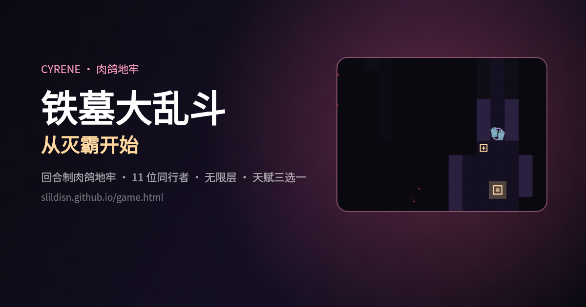

# 🕯️ 铁墓大乱斗 (Iron Tomb Brawl) - Demo 版

---

## 📖 游戏简介

> 由 **王纳** 设计、导演并测试，AI 辅助编码完成的 **2D 回合制肉鸽网页游戏 Demo**。

从灭霸开始，一层层往下砸：随机房间、随机怨灵、随机宝箱。招募队友、凑齐羁绊、叠满奇物，用一根手指滑动着把地牢拆掉。

---

## ✨ 最新卖点

### 🖥️ 双人同屏分屏

- **一台设备、两个人开黑**：横屏左右分屏，竖屏上下分屏
- **独立视野**：P1/P2 各自一部摄像机，各看各的半屏
- **独立仇恨**：怪物会随机锁定任何一名玩家，AOE 同时命中两人
- **各自带队**：每人最多 5 名队友，独立队列跟随、独立羁绊、独立天赋
- 触屏严格分区：左半屏归 P1，右半屏归 P2，双指可同时操作

### 🎭 沉浸式剧情

- **赛博朋克开场白**：打字机逐字播放，点击先补全再关闭
- **三段 BOSS 台词**：第 10 层红字铁墓、第 20 层绿字迪克、第 30 层紫字双 BOSS
- **随机事件房**：献祭生命换奇物，或赌一瓶回满/减半的怪药水
- **角色专属台词**：招募、升级三选一、激活羁绊时弹出各自的口头禅

### 🌐 全平台支持

- **网页**：打开即玩，无需安装
- **PWA**：安装到主屏幕，全屏运行、断网可玩
- **安卓 APK**：独立安装包，内置同款玩法
- **赛博朋克 UI**：霓虹紫双人 HUD、发光分割线、深紫半透明面板

### ⚔️ 史诗级三段 BOSS 战

- 第 **10 层** 铁墓 / 第 **20 层** 黑客迪克 / 第 **30 层** 双 BOSS 混合双打
- 第 30 层无楼梯，两人全部倒下 BOSS 才算通关，击杀其一另一个立刻狂暴

### 🛡️ 硬核防盗机制

- 域名锁定、反调试、作者标记校验
- 未授权部署或篡改源码 → 黑屏问号处决

---

## 📜 署名与原创说明

- **Designed & Directed by 王纳**
- 本项目未引入任何游戏引擎、框架或第三方 JS/CSS 库；代码、UI、数值与玩法实现均在本仓库内完成。
- 角色名称、立绘与同人素材版权归原权利方所有；本项目为非官方同人作品，代码与玩法实现归王纳所有。
- 完整条款见 [LICENSE](./LICENSE)。

---

## 🧑‍💻 开发者手记

> 本项目耗时仅 **24 小时**，没有使用游戏引擎，纯 **HTML5 Canvas** 实现。
> 王纳负责设计、导演、测试与验收；AI 辅助编码与部署。

---

**Demo 版本 · 持续更新中**

[仓库](https://github.com/Slildisn/slildisn.github.io) · [在线试玩](https://slildisn.github.io/game.html) · [下载 APK](https://github.com/Slildisn/slildisn.github.io/releases/latest)

