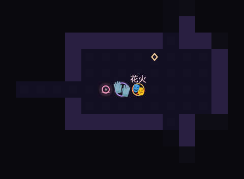
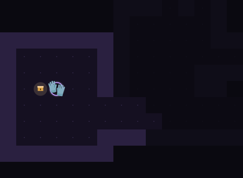
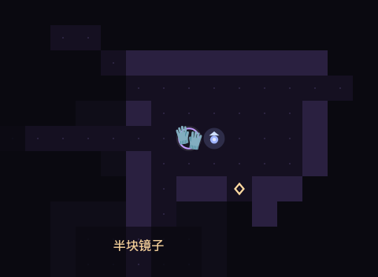

# 铁墓大乱斗


### [▶ 立即开玩 · slildisn.github.io/game.html](https://slildisn.github.io/game.html)


---

## 📱 开发故事

> **本项目完全由玩家在手机上，通过纯对话指挥 AI 从零开发完成。**

没有电脑、没有 IDE、没有构建脚本 —— 从第一行代码到上线部署，全部发生在手机上的对话里。地图生成、战斗结算、音效合成、UI 排版、离线缓存，敲下需求，AI 改代码，刷新页面看效果，如此往复。

## 这是什么

《铁墓大乱斗》是一款跑在浏览器里的**回合制地牢肉鸽**。从灭霸开始，一层一层往下砸：随机房间、随机怨灵、随机宝箱，每 5 层一只铁墓守门，层数没有上限。

你可以在开局挑一位跨次元角色，一路招募队友、凑齐羁绊、叠满奇物，用一根手指滑动着把整座地牢拆掉。

## 核心特色

- 🎭 **13+ 位跨次元角色** —— 星穹列车组、二次元之光、混沌乐子人……不同阵营各有各的打法，还有需要碎片解锁的特殊角色
- ⚔️ **队伍与羁绊系统** —— 最多 5 人满编小队，队友像贪吃蛇一样踩着你走过的路跟随；凑齐同阵营触发全队增益，招募面板会预判羁绊增减
- 🎲 **深度肉鸽循环** —— 局内奇物、天赋、可叠加被动层层叠加强化；局外用记忆碎片永久加点（生命 / 攻击 / 暴击 / 闪避），越玩越强
- 📱 **极致移动端体验** —— 滑动手势移动，撞到敌人就是攻击；支持 **PWA 安装到主屏幕**，全屏运行、断网可玩
- 📊 **全队终极属性面板** —— 右上角一键查看主角与每名队友的最终数值（攻击 / 暴击 / 闪避 / 反伤 / 吸血 / 视野），羁绊、天赋、奇物全部计入

## 截图

| 开局 | 战斗 | 铁墓 |
|---|---|---|
|  |  |  |

| 招募队友 | 宝箱 | 商店 |
|---|---|---|
|  |  |  |

## 怎么玩

- 在画面上下左右**滑动**走一步（电脑用 `WASD` / 方向键），撞到敌人就是攻击
- 走完一层，踩上光门进下一层；门的方向看顶部「门」那一栏
- 升级会弹出三选一天赋；每层还会遇到宝箱或记忆商人
- 死亡即结束，按层数结算记忆碎片，用来永久提升初始属性、解锁特殊角色
- 手机浏览器打开后「添加到主屏幕」，就能当独立 App 全屏游玩

## 技术

```
index.html      昔涟主页（从「路口」进入游戏）
game.html       游戏本体：Canvas 渲染 + Web Audio 合成 + localStorage 存档
manifest.json   PWA 清单
sw.js           Service Worker（离线缓存）
icon-*.png      安装用图标
assets/         主页素材
docs/shots/     README 截图
```

- 无框架、无构建、无外部依赖，单个 HTML 文件就是全部逻辑
- 地图、角色、敌人、粒子全部 Canvas 绘制；角色形象用系统 Emoji，缺字时自动退回应援色圆盘
- 音效与 BGM 全部由 Web Audio 实时合成，首次交互后才启动
- 存档：`localStorage`（局内进度 + 碎片 / 最高层 / 加点 / 解锁状态）
- PWA：`manifest.json` + `sw.js`，断网也能继续玩

## 说明

这是《崩坏：星穹铁道》角色**昔涟**的同人小站的一部分，非官方作品。角色名称与形象归原版权方所有；页面里的代码可以随意看、随意改。
