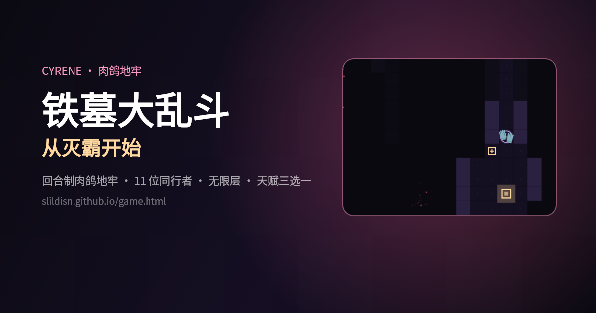
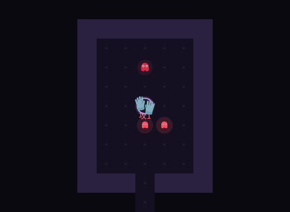
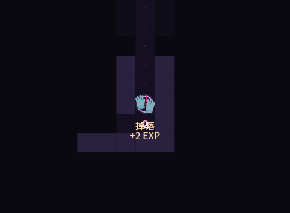
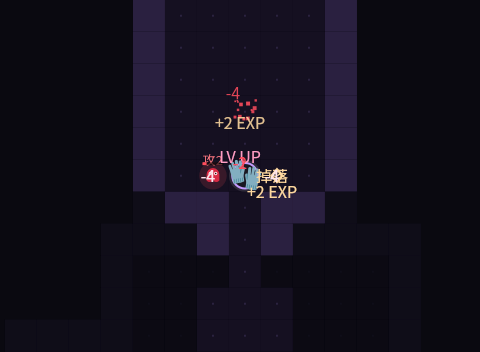
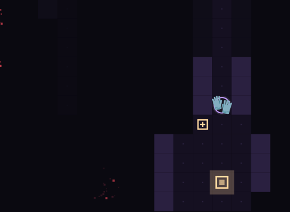
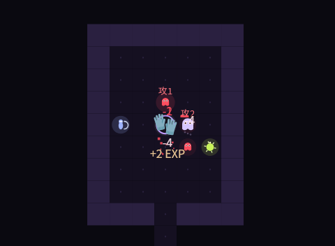

# 铁墓大乱斗：从灭霸开始

> 昔涟同人站里的**回合制肉鸽地牢**。纯前端、零依赖、零图片素材——地图用 Canvas 画，角色用 Emoji，音效与 BGM 全部用 Web Audio 现场合成。

**[▶ 直接开玩](https://slildisn.github.io/game.html)**



---

## 它在玩什么

从灭霸开始，一层一层往下砸。每层随机生成房间与走廊，找到发光的方块（光门）进入下一层；每 5 层有一只**铁墓**守着门。死了会按层数换成**记忆碎片**，用来永久提升初始血量、解锁隐藏角色。

| 开局 | 光门 | 战斗 | 铁墓 |
|---|---|---|---|
|  |  |  |  |

三种新怨灵（游魂 / 暗箭手 / 自爆虫）：



## 内容清单

- **11 位同行者**：丛雨 🗡️、未花 🌸、流萤 ✨、花火 🎭、灭霸 🧤、猪猪侠 🐷、奶龙 🦖、胖橘 🐱、塔菲 🐶，外加两位隐藏角色（迷迷 🐇 / 德谬歌 🌑，用碎片解锁）
- **5 种怨灵 + 铁墓**：碎片（快）、残影（硬）、**游魂**（半速移动、血厚）、**暗箭手**（不靠近，隔 2–6 格放冷箭，箭会飞行、你走开就能躲）、**自爆虫**（一回合冲两格，贴身即爆，伤害高但自己也没了）
- **无限层**：每 5 层一只铁墓，血量与攻击随层数上涨；层数没有上限
- **12 种天赋**：升级时三选一，攻击/暴击/闪避/吸血/视野/反伤…… 有取舍，有嘴
- **8 件奇物**：`泣血的怀表`（走 10 步削周围敌人）、`断掉的小指`（攻 +2 血上限 -3）、`空心的骰子`、`半块镜子`、`冷藏的心脏`、`无眼的护符`、`会说话的牙齿`、`生锈的硬币`
- **4 个角色彩蛋**：灭霸打 BOSS 打响指（灰飞烟灭 + 带走一半小怪）、丛雨「刀归鞘」慢镜、花火有概率把 BOSS 变小、奶龙阵亡留残影
- **记忆碎片成长**：最高层 / 累计击杀持久记录，死亡换碎片，升级初始生命或解锁角色
- **打击感**：屏幕震动、红色伤害飘字、击杀碎裂粒子、拾取弹窗
- **声音**：脚步、打击、受击、拾取、升级、BOSS 登场；BGM 是程序化循环乐段（普通层柔和，BOSS 层换调加鼓点），首次点按后才启动，避免自动播放限制

## 操作

- 手机：屏幕下方方向键，或在画面上滑动
- 键盘：`↑↓←→` / `WASD`，`空格` 原地等待
- 「撞」就是攻击；敌人也会朝你走一步，撞上互相掉血
- 右侧按钮：重开 / 说明 / 🔊 静音

## 技术

```
index.html      昔涟主页（路口里进入游戏）
game.html       全部游戏逻辑：Canvas 渲染 + Web Audio 合成 + localStorage 存档
assets/         主页用的角色图与表情
docs/shots/     README 截图
```

- 无框架、无构建、无外部网络请求
- 地图、玩家、敌人、粒子全部是 Canvas 绘制；角色形象用系统 Emoji（缺字时自动退回应援色圆盘 + 首字）
- 音效：噪声 + 振荡器合成；BGM：和弦垫 + 贝斯 + 琶音 + BOSS 心跳，`setInterval` 前瞻调度
- 存档：`localStorage['cyrene.rogue.meta']`（碎片 / 最高层 / 累计击杀 / 升级 / 解锁）

## 说明

这是《崩坏：星穹铁道》角色**昔涟**的同人小站的一部分，非官方作品。角色形象与名字归原版权方所有；页面里的代码可以随意看、随意改。
